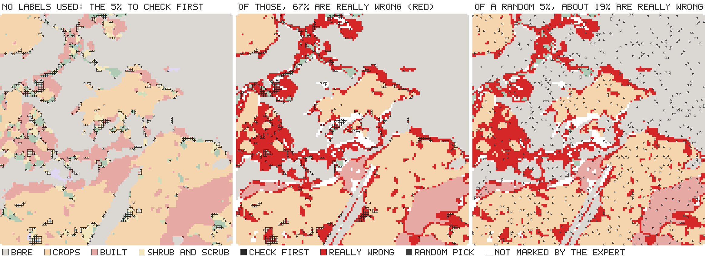

# olmoearth_inferenceX

olmoearth_inferenceX is a Python package for assessing classification maps from Earth-observation models. Without
reference labels, it ranks a map's windows by the model's confidence for manual review, lists the cues behind each
flagged window, and compares two maps of the same area. With a labelled sample, it estimates the error rate and
per-class accuracy with confidence intervals, certifies the most confident part of the map whose error rate is at most a
stated level, and, from labels drawn where two maps differ, names the more accurate map with an exact test and gives an
interval on their accuracy difference. From an agency's published stratified sample (NLCD's, GFC2020's) it grades a
map, or two, with intervals valid at any sample size beside the agency's normal-theory ones.

The package reads the per-pixel probabilities, logits or class scores that a model exports, as GeoTIFF or `.npy`
arrays, and needs no access to the model itself. It was developed on OlmoEarth and does not require torch.

![Structure of olmoearth-inferenceX. Left: Sentinel-2 imagery goes through a model's encoder and decoder to its outputs, a class map and a confidence map. Right: the outputs are pooled to windows. Without reference labels, ranking the windows by confidence gives the review set, and comparing two maps A and B gives the disagreement map. With a labelled sample, a sample of the windows where A and B differ names the more accurate map by an exact test and gives their accuracy difference with a 95% interval; a random sample with reference labels gives the error rate with an exact 95% interval and, by exact zone tests, the certified zone; a sample of each class's confident calls gives each class's error with a 95% interval and the classes not to trust](figures/architecture.png)

## Demo

```bash
pip install "olmoearth-inferencex[geo]"     # without [geo] the package reads .npy arrays only
oe-inferencex demo
```

The demo assesses one Dynamic World tile with expert annotation. The tile was selected by a rule fixed before any
tile was examined, as the lower median by error capture at a 5% budget among the 18 of Dynamic World's 409
expert-annotated test tiles that meet the rule's criteria (annotated on at least 90% of windows, at least three
classes on 5% of the windows each, an error rate between 5% and 35%); the selected tile is therefore typical rather
than the most favourable.



*Left: the 5% of windows ranked first, selected without labels. Middle: the same windows over the map's errors, in
red; 67% of them are wrong, against 19% of the map. Right: a random 5%. The flagged windows hold 17% of the errors;
with 19% of the map wrong and 5% reviewed, no selection of that size could hold more than 26%. A 20% review holds
55%.*

Another map is assessed with `oe-inferencex assess your_map.tif --out audit`. The [quick start](Usage.md#quick-start)
goes from there to an error rate and a certified zone.

## Installation

```bash
pip install olmoearth-inferencex            # the package; no torch
pip install "olmoearth-inferencex[geo]"     # with GeoTIFF input and output
```

The package requires Python 3.11 to 3.13. To work on the repository:

```bash
git clone https://github.com/2imi9/olmoearth_inferenceX.git
cd olmoearth_inferenceX
uv sync
uv run pytest
```

The experiments are in a separate repository, the research record
([Usage: reproducing the experiments](Usage.md#reproducing-the-experiments)).

## Documentation

- [Usage](Usage.md): inputs, commands and the Python API.
- [API reference](reference/index.md): the `oe_inferencex` package, module by module.

The evidence is in a separate repository, the [research record](https://github.com/2imi9/olmoearth_inferenceX-record), with the experiments, their
outputs and the tests that check each recorded result against the released package:

- [Findings](https://github.com/2imi9/olmoearth_inferenceX-record/blob/main/docs/Findings.md#in-short): what holds, what was rejected, and the limits; each
  statement links to its evidence.
- [Recipe](https://github.com/2imi9/olmoearth_inferenceX-record/blob/main/docs/method/recipe.md): what to do and not do when assessing a map.
- [Comparisons](https://github.com/2imi9/olmoearth_inferenceX-record/blob/main/docs/results/comparisons.md): the record of each experiment; the
  [technique ledger](https://github.com/2imi9/olmoearth_inferenceX-record/blob/main/docs/TECHNIQUES.md) lists every technique tried with its verdict.
- [Protocol](https://github.com/2imi9/olmoearth_inferenceX-record/blob/main/docs/method/protocol.md): how results are scored; the
  [claim ledger](https://github.com/2imi9/olmoearth_inferenceX-record/blob/main/docs/method/claims.md); the
  [preregistrations and decisions](https://github.com/2imi9/olmoearth_inferenceX-record/blob/main/docs/plan/index.md).
- [Related work](https://github.com/2imi9/olmoearth_inferenceX-record/blob/main/docs/related_work.md) and the
  [technical report](https://github.com/2imi9/olmoearth_inferenceX-record/blob/main/report/main.pdf).

## Licence and contact

Apache License 2.0 ([LICENSE](https://github.com/2imi9/olmoearth_inferenceX/blob/main/LICENSE)); citation in
[CITATION.cff](https://github.com/2imi9/olmoearth_inferenceX/blob/main/CITATION.cff). Questions and suggestions as
[GitHub issues](https://github.com/2imi9/olmoearth_inferenceX/issues).
